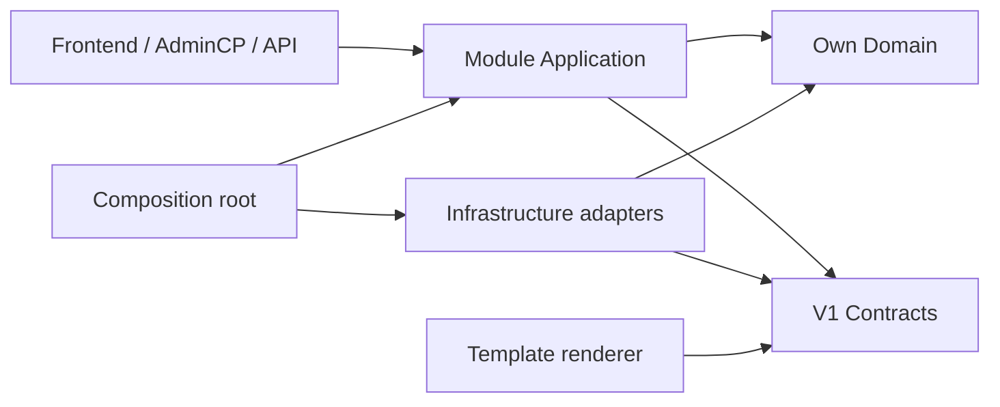

# Architecture and current foundation

Decision 109 makes Chaos, Order and Singularity the three primary APIs. The four provider contracts below are derived specializations, not additional primary APIs. Private Kernel/Apis and Bootstrap/Apis now mediate health and synthetic ranking reads; other modules remain transitional. See [integration](docs/api/WEBSITE_INTEGRATION.md) and [API architecture](API_ARCHITECTURE.md).

Decision 105 adds the explicitly checked mandatory `Kernel/Plugins` owner and
an internal approval port/service/SQL journal, composed lazily by Bootstrap after
separate administrator authorization. This foundation is independent of optional
game transports and imports no module internals. It implements only approval and
enable/disable policy; configuration/migration state and executable HTTP/worker
integration remain pending. See docs/PLUGIN_APPROVAL_STORAGE.md.

Decision 104 adds bounded data-only manifest/package discovery under
`src/Bootstrap/Plugins`, with no executable loading, HTTP integration, persistent
approval or public SDK. See docs/PLUGIN_MANIFEST.md for the canonical format and
docs/PLUGIN_RUNTIME_MIGRATION.md for inspected consumers and selected future
ownership/contract boundaries. Static module composition is unchanged.

## Four-layer removable provider API (design only)

The target kernel hosts a versioned `MainAPI` plus separately versioned `GameTypeAPI`, `DatabaseTypeAPI` and `SchemaAdapterAPI`. Example removable providers: `/plugins/zenda.game.mu`, `/plugins/zenda.db.mssql`, `/plugins/zenda.schema.muemu`, and a generic consumer `/plugins/zenda.rankings`. A game type, its transport protocol, and its emulator-specific layout are different identities. Bind an explicit verified provider set per game profile in website MSSQL. **Website persistence MSSQL remains kernel-owned and available without optional external-game database plugin folders.** Any absent provider disables only its dependent profile/capability, not unrelated features. For normative boundaries and tests see `API_ARCHITECTURE.md` and four detailed API manuals. This has not been implemented in the runtime.

## Plugin-first target (planned; not current runtime)

A **small trusted PHP kernel** will discover folders directly beneath `/plugins`
for each new HTTP request, validate data-only manifests and build a scoped,
versioned, request-local registry. Approved compatible plugins contribute routes,
AdminCP pages/menus, service capabilities, events, jobs, assets and GrapesJS
widgets through public `PluginAPI`; no runtime requirement on absent optional
package files. Dropping a complete approved folder into `/plugins` makes it
available without editing core; removing the folder removes its contributions on
the next HTTP request and leaves core/unrelated plugins running. Configuration,
trust approvals, migrations and preferences belong in website-owned MSSQL; code
presence comes only from the filesystem. **Core works with `/plugins` empty**.

This is an **architectural direction**, not a claim that today's fixed
`SourceLayout`/Bootstrap/`architecture/*.json` already implements it. Existing
premium roots and static modules remain compatibility islands until separately
migrated and verified. Never execute untrusted PHP during discovery. In-process
PHP plugins are trusted code, not a hostile-code sandbox. See `PLUGIN_SYSTEM.md`.

The term drag-and-drop refers here to **folder installation**, not just GrapesJS
visual layout dragging. The editor may additionally consume versioned plugin
widget schemas; when a plugin disappears, saved projects remain intact with a
safe placeholder. Keep V1-V5 frozen and preserve MSSQL, game write and payment
boundaries throughout the migration.

Decision 103 adds independently owned GameData Infrastructure ODBC support for
fixed website guide documents. Its eight-MiB Unicode wire/profile imports no Admin
internal code. Shared event/loot persistence checks initialization/write/readback/
commit and replay rollback acknowledgements, with private cleanup errors. Existing
ports, schemas, replay bytes and V1-V5 remain compatible. Actual owned SQL evidence
is separate from pending guide HTTP/calendar and native scheduling/drops. See
docs/GUIDE_ODBC.md.

Decision 102 adds test-only SQL HTTP composition using existing Bootstrap
constructor injection. Real Admin settings/operational and Identity credential
adapters run under a fixed restricted database principal. No public port, schema,
production composition or runtime source changes are required. A guarded loopback
router, process-only secrets and ownership-marked fixture attachment stay outside
the public entry point. Same-name player denial uses explicit file fixtures;
whole-site SQL/default-factory and deployment evidence remain pending. See
docs/MSSQL_HTTP.md.

Decision 101 adds a separately owned Identity Infrastructure ODBC profile for
DDL 009 administrator credentials. Its fixed bounded ASCII VARCHAR fields use
explicit scalar bindings, exact validated initialization readback and redacted
rollback failures. No shared transport port, cross-owner internal dependency,
schema or frozen V1-V5 change is needed. Bootstrap/import consumers retain their
signatures; actual local SQL evidence does not activate modules or certify HTTP
composition/deployment. See docs/ADMIN_CREDENTIAL_STORAGE.md.

Decision 099 keeps ODBC transport, parameter encoding/profile checks and Admin
SQL dialect logic inside Admin Infrastructure. Private bootstrap driver selection
is explicit, defaults to sqlsrv and never falls back after failure. No shared
service locator, new public contract or imports of Admin internals by another
module are introduced. Admin's existing ports/JSON/replay formats remain stable.
Its ODBC wire strategy is bounded UTF-16LE input streams and validated SQL hex
text projections, retaining actual PDO driver identity. Other stores remain
unsupported until their own transport evidence exists; this does not activate
production modules, public shops or game writes. See docs/MSSQL_LAB.md.

Decision 098 adds private administrator draft inspection through independently
frozen V5 ports. Core authorizes before fixed optional composition; each package
service repeats database.inspect/admin before its lazy store opens a website
connection. Views are package-owned and reuse V2.PageLayout. Only stored documents
supply status/count/SHA/escaped JSON; absent/broken packages or SQL state refuse
without fallback or writes. V1-V4 and public preview contracts stay unchanged;
database shops/purchases, licensing and native commerce remain disabled.

Continuation audit keeps native market execution unavailable until the protected
mutation gateway coordinates all effects; injected writers and escrow metadata
cannot activate it. SQL template storage now enforces immutable revisions, exact
draft CAS and one-transaction complete-collection import with FK-correct ordering.
Active SQL publication refuses until its validated pipeline exists. See decisions
076-077, docs/MARKETPLACE.md and docs/TEMPLATE_STORAGE.md.

Decision: a modular PHP 7.4 monolith with explicit ports and adapters, a single
composition root and separate server-owned template rendering. The original
site mixes global helpers, modular backend services, direct SQL controllers,
commerce adapters and scheduled work. Its behavior and validated compatibility
knowledge are inputs; none of its PHP is a runtime dependency of the new project.

News authoring is delegated to an isolated Drupal service with its own modern
PHP runtime. Content's Infrastructure reads anonymous published JSON:API articles
through an internal query port; no Drupal code is loaded into the PHP 7.4 process.
The frontend and protected game/template boundaries remain in Zenda. All website
configuration is authoritative in MSSQL; files are permitted for disposable cache
only. Existing file/SQLite configuration is an offline prototype pending migration.
See docs/DRUPAL_NEWS.md and DATABASE.md.

Core website settings now have an internal revisioned SQL adapter and one
Bootstrap selection shared by public/staff/player routes. Its MSSQL path is
prepared but lacks actual SQL Server evidence; owned SQLite fixtures verify
transaction/HTTP behavior. Database mode never falls back to file settings.
An additive version-2 operational record now supplies Drupal connection and
strict runtime policy in database mode, with a separate administrator editor.
Core version-1 fields/fingerprints remain compatible. Both records share an
Infrastructure transaction journal but have independent revisions/transactions.
See docs/OPERATIONAL_CONFIGURATION.md; no atomic cross-record snapshot is claimed.
GameData's event timetable now has its own SQL adapter, preserving the existing
v1 full snapshot/history via pure shared module-domain rules. Bootstrap supplies
the selected store to timetable/calendar/staff routes and alone wires the private
connection factory. Missing event state has no file/example fallback. Event/core/
operational transactions remain independent. See docs/EVENT_TIMETABLE.md.
LootGuideStore now also has a full-history SQL adapter. Event/loot infrastructure
shares fixed-identity PdoGuideDocument and WebsiteGuideImport inside GameData;
module-domain validators reconstruct histories and check command fingerprints.
Separate records retain generated loot IDs and native scheduling/drop boundaries.
ConfigurationImportPlan composes four source readers only, with no database/apply
path, combined-snapshot claim or configuration values in output.
The remaining website configuration migration is inventoried in
docs/WEBSITE_CONFIGURATION.md; this does not activate production modules.
Decision 093 starts the remaining catalog work with free/core mapping declarations
inside GameData. The new store serves an authorized draft inspector only; it does
not feed native adapters. Shop/VIP database-mode routes refuse pending catalog
bindings. Consumer/package destinations and the required contract/autoload/check
migration are in docs/CATALOG_CONFIGURATION.md; physical premium separation and
paid catalog persistence are not implemented by this step.

Decision 094 adds a fixed SourceLayout for the two reviewed optional Webshop/VipShop
package roots and matching Composer declarations. Runtime lookup, source discovery,
layer/owner checks, static binding paths and impact analysis now recognize them.
Unknown package PHP is linted and rejected; moving code cannot escape checks.
Core has no imports of premium internals/composition. No services have moved and
these planned catalog entries provide no executable capabilities. See
docs/CATALOG_CONFIGURATION.md for the remaining contract/consumer migration.

Decision 095 physically extracts VIP's synthetic catalog, deterministic preview
service and presentation into its premium package. Additive frozen V2 PageLayout
and VipShopPreview ports replace its internal GameData currency-writer coupling
and its mixed Content view. Free Content supplies the shared theme shell through
a public port; core imports no premium implementation. Bootstrap selects a fixed
owned composition closure only in explicit local file-sandbox mode and validates
its public result. Missing/malformed package refuses privately. Database mode,
native commerce, persistence and licensing remain unavailable. Existing URL/form/
escaping/theme consumers are retained; see CONTRACTS.md for the explicit internal
purchase API migration. Other mixed paid responsibilities still need extraction.

Decision 096 likewise extracts Webshop catalog/pricing, display projection,
prototype order model and presentation into packages/premium/webshop. The separate
V3.WebshopPreview freeze leaves V1/V2 unchanged and reuses free V2.PageLayout.
Pure proposals replace the old internal writer/order simulation; fake native
hex/serial/slot generation is removed. Bootstrap alone selects its fixed offline
composition, with private absence/failure and the existing HTTP guards. Packages
depend on their own modules and public contracts only; no new GameData read/writer
port grants native authority. See docs/WEBSHOP_PREVIEW.md. Paid catalogs, licensing,
full distribution and other paid extraction remain pending.

Decision 097 adds each premium owner's strict draft domain, internal CatalogStore,
owning immutable SQL adapter and source reader. Services explicitly built from a
store never choose defaults after failure. New frozen V4 CLI provisioning ports
keep free scripts/loaders independent of paid internals. Fixed catalog composition
receives a lazy connection factory; scope/backend/reviewed source fingerprint
checks precede connecting. V1–V3 and existing preview behavior stay unchanged.
Database storefront activation remains unavailable; storage is website metadata,
not license/native fulfillment. See docs/PREMIUM_CATALOGS.md.

Full microservices would add deployment and consistency costs without a present
need. A new framework requiring PHP 8 would break the inspected deployment
baseline. Strictly repeating every Clean Architecture layer across trivial
features adds ceremony. Domain/Application/Infrastructure/Presentation boundaries
are used only within real module responsibilities, with shared public contracts.

## Open-source core and commercial module licensing

The architecture supports a dual distribution model:
- **Open-source unencrypted core**: Foundational CMS runtime, template/theme system,
  account identity, public rankings, news, drop guides, and frozen public contracts (`src/Contracts/V1`).
- **Premium/paid modules**: Inventory/warehouse functionality, visual webshop,
  player item market, character marketplace, guilds/alliances and castle siege
  are paid modules, optionally encrypted under individual commercial licenses.
- **Payment methods**: PayPal and MercadoPago are free modules; all other payment
  method modules are premium/paid. Free gateway implementations depend on core
  contracts and remain independently distributable from premium commerce modules.
- **Physical separation**: Core/free and premium/paid code must occupy separate
  physical directories/packages. The free distribution must load without premium
  packages. Existing mixed offline modules require an explicit responsibility,
  path/catalog and consumer migration; physical separation is still pending.
- **Builder and template distribution**: The Enjin-style GrapesJS builder is
  free/core. Free/default templates may ship separately from paid premium
  predesigned template packs. Their starter project definitions, assets and bundle
  metadata require physically separate free/premium directories/packages; the
  free builder/templates must run without premium template packages. Installed
  editable projects/revisions remain authoritative in website-owned MSSQL.
- **Architectural boundaries**: Strict modular isolation ensures commercial modules plug into
  declared contracts and extension points without polluting or coupling the open-source core.

Implemented layout: `src/Modules/<Name>/<Layer>`, `src/Contracts/V1`,
`src/Bootstrap` and `public/`. Identity and Content implement a local-only phase-4
slice: sandbox credentials/sessions/CSRF/throttling/authorization, public content
and authorized plaintext news persistence. The public runtime has its own autoloader
and does not depend on developer checks or legacy PHP. Private state is outside
the source and all webroots, not in project var/. Editor resources, template
rendering and production game adapters remain future work.

`architecture/policy.json` defines allowed intra-module dependencies. Cross-module
implementation imports are forbidden; consumers call contracts. Explicit
dependencies and capability ownership live in `architecture/modules.json` and
`capabilities.json`. Planned modules do not advertise executable availability.
Composition may bind implementations; no other layer obtains infrastructure
through a container, global helper or dynamic include.

The full reconstruction modules remain planned. `architecture/runtime.json`
explicitly describes the executable offline slice; a partial sandbox is not
evidence that every production module capability is ready. Bootstrap composes
local module services and handles HTTP/security pipeline concerns. NewsService
enforces the existing Authorization port before publication; a presentation
caller cannot bypass that policy. New module-local repository/session ports are
internal extension points, not changes to the frozen cross-module V1 contracts.

MU Online is the first target. Other games remain possible through future adapters
without an implementation commitment now. Website content/identity stays separate
from native game identity, item formats and delivery rules. Do not impose MU item
layouts or schema assumptions on a future adapter; require its own verified
capabilities and synchronization evidence before activation.

`scripts/verify.php` lints PHP, checks metadata, token-scans dependencies and
compares frozen contracts. Tool regression tests exercise forbidden dependencies,
cycles, missing capabilities, missing bindings and template compatibility. These
checks cover a supported PHP coding subset; they are not a whole-program type
system or proof of authorization, transaction safety or arbitrary dynamic code.
The exact limitations and missing runtime suites are recorded in TESTING.

Website data will use an independently managed store; game data stays authoritative
in the game database. Game writes require an approved synchronization adapter,
offline verification and locks, not just a successful SQL connection. Rendering
and previews must have no mutation authority. See INVARIANTS and DATABASE.

The later offline slices add separate website-player/staff session realms and
private Community support, plus GameData market planning, synthetic Siege views
and a website-maintained loot guide. New ports stay module-local; Bootstrap
composes implementations and all cross-module authorization still uses frozen
V1 Authorization. Website state, replay results and minimal audit projections
commit in one locked snapshot. These file adapters do not establish production
SQL durability or native mutation safety. See docs/PLAYER_SUPPORT.md and
docs/SIEGE_AND_LOOT.md for implemented boundaries.

Persistent website event configuration extends the internal EventScheduleReader
with EventScheduleStore. Bootstrap binds public queries and the authorized editor
to the same locked snapshot. Calendar export enumerates bounded UTC occurrences
from one committed revision; its presentation serializer has no external transport
or native mutation authority. See docs/EVENT_TIMETABLE.md. Frozen cross-module
contracts and template component properties are unchanged.

Identity owns website preferences through an internal WebsiteProfileStore. Its
service applies self-scoped authorization and publication policy; Bootstrap
separates owned editing/preview, public lookup and synthetic native dossiers.
Preference/replay/journal writes share a locked snapshot. Authenticated V1
AccountReader is unchanged. See docs/WEBSITE_PROFILES.md for compatibility limits.

WebsitePasswordStore is an internal Identity extension implemented by file/PDO
account adapters. PlayerIdentityService passes the private session credential
version into the owning lock/transaction; credential replacement, reset-token
invalidation and minimal replay/history commit together. Old constructors and
V1 consumers retain signatures. See docs/WEBSITE_PASSWORDS.md.

Content's public announcement archive/detail routes reuse NewsRepository and
NewsService. Search/count/pagination and explicit public projections belong to
Application; Bootstrap validates HTTP query shapes and SiteView escapes output.
The homepage alone limits its list; existing full-data/admin/template consumers
retain behavior. No storage or frozen public contract changes. See
docs/ANNOUNCEMENTS.md.
