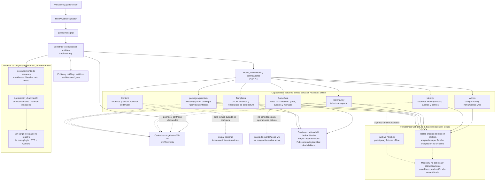
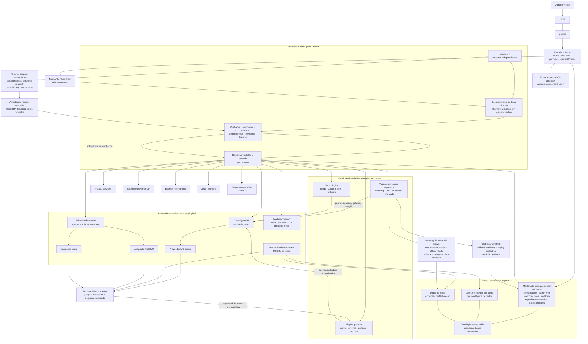

# Diagramas de arquitectura

Estos diagramas resumen el estado documentado de ZendaMod Next al 19 de octubre
de 2026. El primero describe la implementación actual y sus límites; el segundo
es una visión objetivo, no una promesa de que esas capacidades ya existan.
`STATE.md` continúa siendo la fuente de verdad del progreso.

Para una vista visual en árbol expandible, abrir
[ARCHITECTURE_DIAGRAMS.html](ARCHITECTURE_DIAGRAMS.html) en el navegador.
Esta versión Markdown conserva los diagramas Mermaid como alternativa.

## Arquitectura actual

### Cómo leer el estado actual

- El punto de entrada real es `public/index.php`; la composición y las rutas son
  estáticas, no ensambladas por plugins independientes.
- Existen capas por módulo y contratos V1–V5. Los estados de `architecture/`
  describen el plan completo y no significan que todos los módulos estén
  habilitados en producción.
- La carpeta `src/Bootstrap/Plugins` valida paquetes/manifiestos sin ejecutar su
  PHP; el kernel también tiene políticas y almacenamiento de aprobación/revisión.
  Todavía no hay el ciclo de vida HTTP de añadir, quitar y volver a añadir un
  plugin ejecutable.
- Hay adaptadores preparados para persistencia web MSSQL y pruebas SQL acotadas,
  pero no equivalen a una instalación de producción certificada ni a conexión
  con las bases nativas de MU. Archivo/SQLite se conserva como prototipo offline,
  no como fallback silencioso del modo DB.
- La integración de Drupal es de lectura de noticias. Webshop/VIP y varias
  proyecciones de MU son sintéticas; no realizan entregas nativas.

## Arquitectura objetivo al completar la migración

### Propiedades del destino

- Cada plugin entra por **MainAPI**. `GameTypeAPI`, `DatabaseTypeAPI` y
  `SchemaAdapterAPI` son contratos separados: juego, motor/transporte y esquema
  de emulador no son intercambiables.
- El MSSQL del sitio pertenece al kernel y no depende del proveedor opcional de
  base de datos del juego. Los datos del sitio, cuentas y juego pueden compartir
  una base o estar separados; el perfil de realm define la combinación.
- La presencia física determina si el código está disponible; la aprobación y
  configuración se conservan en MSSQL. Quitar código revoca sus contribuciones,
  no borra sus datos. El kernel debe funcionar con `plugins/` vacío.
- Ningún plugin de funciones consulta directamente tablas nativas del juego:
  usa capacidades/puertos normalizados. Lectura no concede autorización de
  escritura. Las mutaciones y pagos siguen sus respectivos controles de
  seguridad, idempotencia y auditoría.
- La transición será gradual: los módulos estáticos y paquetes premium actuales
  permanecen hasta migrarlos y probar equivalencia. El objetivo no se alcanza
  simplemente por tener esta especificación.
